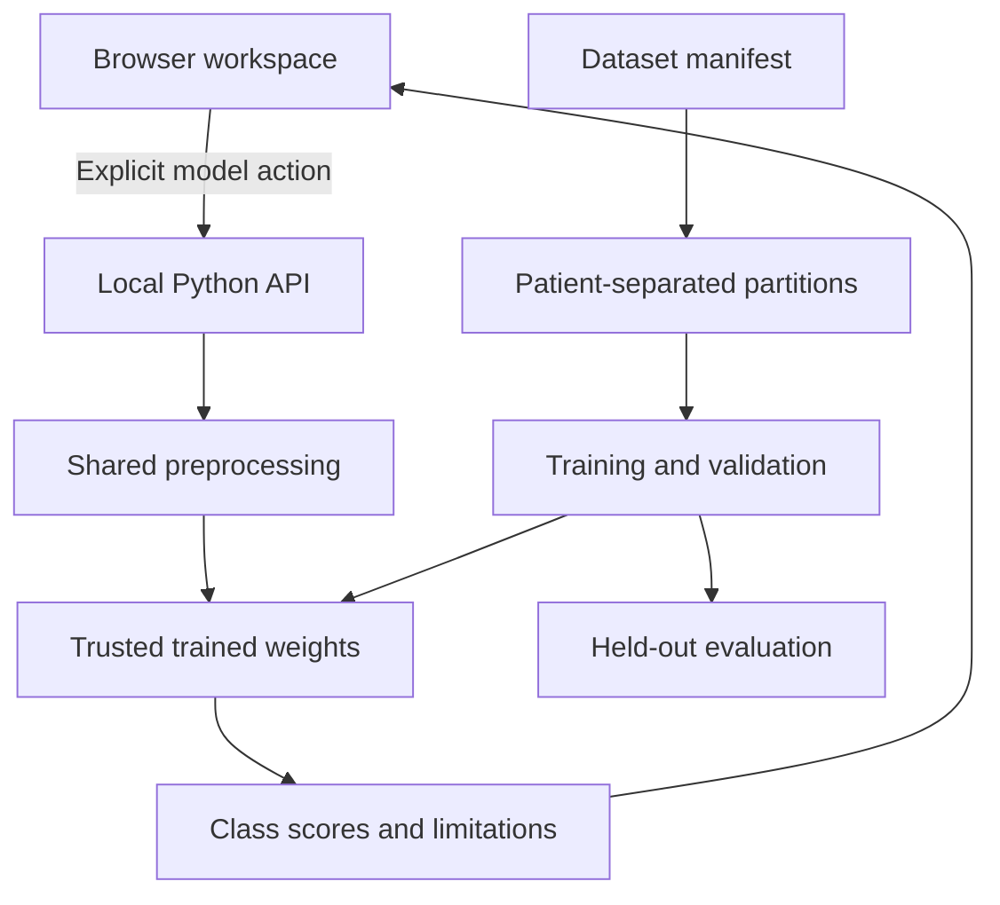

# Five-minute faculty demonstration

## Suggested project title

**LungLens: An Educational Lung Image Classification Workflow with an Interactive Web Interface**

Use “inspired by the 12 Sigma lung screening concept” as context, not a claim that the proprietary system or its clinical performance was reproduced.

## Before presenting

- Open the project in VS Code and run the server using README instructions.
- Check that Datasets & model says the local API is connected.
- Download one synthetic sample and keep it ready.
- Open `backend/train.py`, `backend/common.py`, `backend/inference.py` and `models/demo/evaluation.json` in editor tabs.

## Demonstration sequence

1. **Interface (45 seconds):** Show the responsive dashboard, local upload, zoom and brightness. Explain that the application separates scripted sample results from computed model inference.
2. **Live computation (60 seconds):** Upload a bundled synthetic PNG and click Run local model. Explain that the included weights learned three artificial shapes. They have not learned cancer detection. Download the JSON report.
3. **Training code (60 seconds):** Show common preprocessing, the patient/group split guard, train-only gradient updates, validation checkpoint selection and test metrics. Point out the NumPy / PyTorch / TensorFlow options.
4. **Dataset (45 seconds):** Show the included 180-image manifest and the official real CT dataset link. Explain that real data uses normal/benign/malignant categories, and related slices must stay in one split.
5. **Staging (30 seconds):** Open the Stage 0–IV cards. Explain that classification labels do not establish cancer stage. The application deliberately returns Stage: Not assessed.
6. **Limitations and next work (60 seconds):** Present real-data preparation, stronger models, patient-level evaluation, external validation and a separately hosted production Python API as future work.

## Questions you may be asked

**Is this a real cancer detector?**
No. The delivered trained model is a functioning artificial-pattern demonstration. The real-data training path is provided but no clinically validated cancer classifier is included.

**Why are TensorFlow and PyTorch both present?**
They are alternative implementations for comparison. One is enough for a single deployment. The lightweight NumPy option makes the first demonstration easy to run.

**Is this deep learning?**
The shipped baseline is a single dense linear classifier with softmax, not a deep CNN. A CNN can be a later research extension after the dataset and evaluation protocol are established.

**What does the 94.44% number mean?**
The NumPy run correctly classified 34 of 36 held-out synthetic images. It is not a cancer detection accuracy figure.

**Why can't a high model score mean Stage IV?**
A class score concerns membership in the model's classes. Stage describes disease extent and needs clinical evidence that this image classifier and its labels do not provide.

**Will Vercel run the Python model?**
The provided deployment publishes the static frontend. Local Python inference works for this demonstration; online model inference needs a separate production backend integration.

## Architecture

## Source notes

Dataset citation and preprocessing limitations are in DATASETS.md. Staging content links to NCI. Optional framework implementations have not been runtime-tested in the build environment; do not claim those training runs were completed until you run them yourself.
